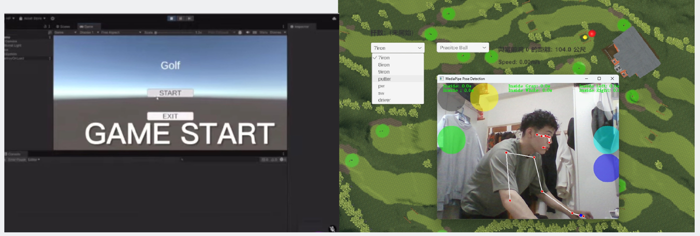
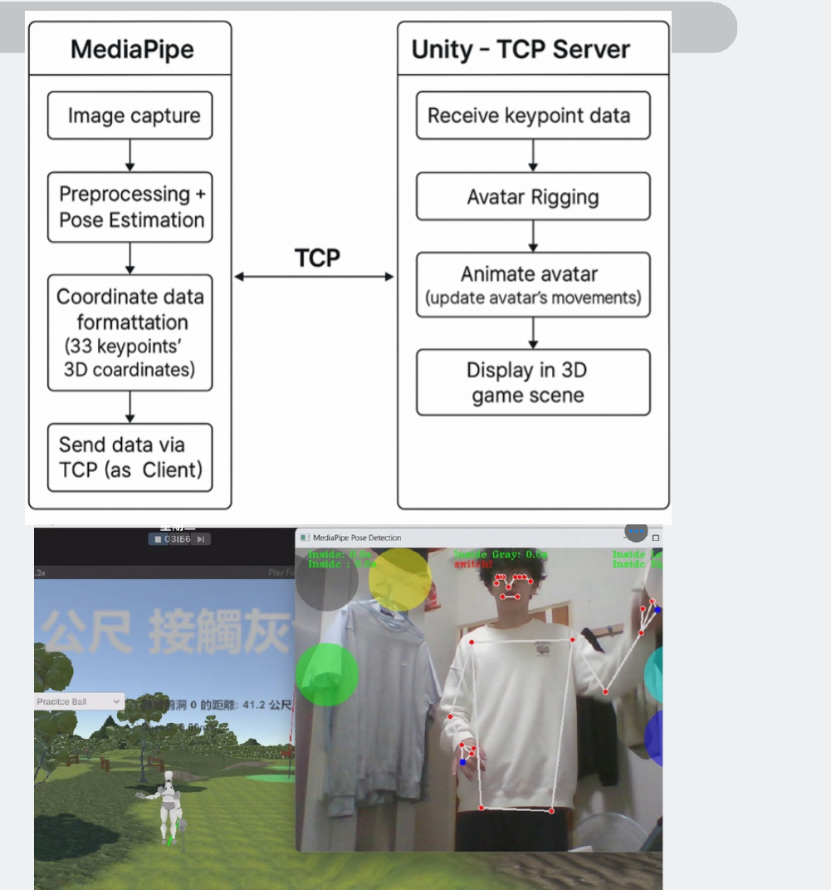
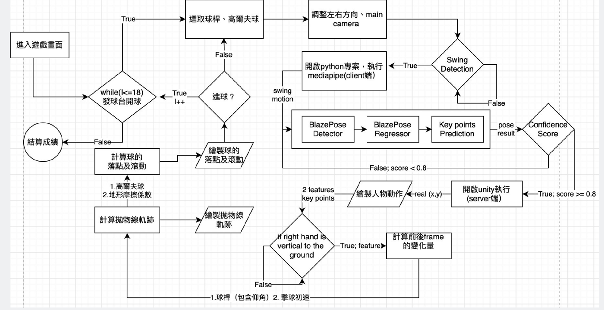
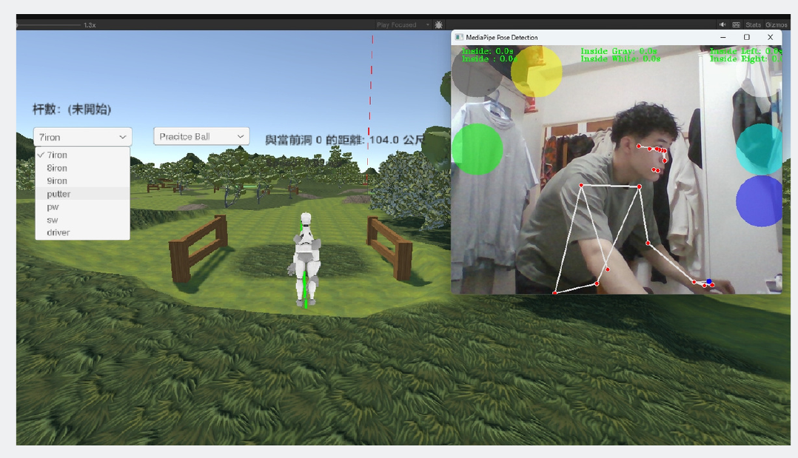

# Contactless Golf Simulator

Play golf in front of a webcam — no club, no ball, no course fee.
MediaPipe tracks your swing in real time, and a Unity game turns it into a shot on a 3D course modeled after a real golf club in Taiwan.

> Undergraduate capstone project, Department of Computer Science and Information Engineering, National Taipei University (Jul 2024 – May 2025)



▶️ **Demo video:** https://www.youtube.com/watch?v=CsEDxNdRhNc

## Features

- **Swing-driven shots** — launch speed is estimated from the player's elbow and wrist motion at the moment of impact.
- **Real-time avatar** — body keypoints stream into Unity to animate a 3D character that mirrors the player.
- **Realistic physics** — club loft and carry distance (driver, irons, wedges, putter), ball properties (mass, friction, spin resistance, coefficient of restitution) and projectile motion.
- **Real-course terrain** — fairways, greens, bunkers and trees laid out after a real course in Miaoli, Taiwan.
- **Touch-free controls** — hold your hand over an on-screen target to start a shot, aim left or right, switch camera views or switch clubs.

## How it works



1. **Pose tracking (Python)** — `pose_tracking/pose_client.py` reads the webcam with OpenCV and runs MediaPipe Pose (BlazePose, 33 keypoints).
2. **Streaming** — the selected keypoints are sent to Unity over a local TCP socket (`127.0.0.1:6001`).
3. **Swing detection (C#)** — `posenetserver.cs` receives the keypoints, moves the avatar's joints, and detects impact when the right forearm (elbow → wrist) is vertical to the ground. The joint velocity between the frames before and after impact sets the launch force.
4. **Ball flight (C#)** — `BallInitialForce.cs` and `BallFriction.cs` launch the ball, simulate its flight and roll, and `HoleTrigger.cs` scores the hole.

<details>
<summary>Game flow chart</summary>



</details>

### Gesture controls

| Target | Action |
|---|---|
| 🟢 Green | Start the shot |
| ⚪ Gray | Confirm and move to the next shot |
| 🟡 Yellow | Switch camera (first person / third person / bird's-eye) |
| 🔵 Light blue | Aim left |
| 🔵 Dark blue | Aim right |
| ⚪ White | Switch between iron and putter |



## Repository layout

```
pose_tracking/
  pose_client.py          MediaPipe pose tracking, gesture targets, TCP client
unity/Assets/Scripts/
  posenetserver.cs        TCP server, avatar animation, swing → launch force
  BallInitialForce.cs     Ball launch, trajectory line, speed display
  BallFriction.cs         Rolling friction by terrain layer (fairway, green, sand, path)
  HoleTrigger.cs          Hole detection and moving to the next hole
  GolfClubSwitcher.cs     Club and ball selection
  CameraSwitcher.cs, ...  Camera views and UI helpers
docs/                     Images used in this README
```

## Running it

**Requirements:** Python 3.9+, a webcam, Unity 6 (6000.0.28f1).

```bash
pip install -r pose_tracking/requirements.txt
```

1. Create a Unity 3D project, copy `unity/Assets/Scripts` into its `Assets` folder, and attach the scripts to the player, ball, cameras and holes in your scene.
2. Press **Play** in Unity — the TCP server starts on port 6001.
3. Run `python pose_tracking/pose_client.py` and stand in front of the webcam.

> The 3D models, terrain textures and course scenery came from Unity Asset Store packages whose licenses don't allow redistribution, so they are not included. This repository contains the code our team wrote.

## Team

| Member | Role |
|---|---|
| Yu-Xiang Pan ([@pan1624](https://github.com/pan1624)) | Pose tracking with MediaPipe, swing-speed estimation, Python ↔ Unity streaming |
| [Teammate] | [Role] |
| [Teammate] | [Role] |
| [Teammate] | [Role] |

## Future work

- VR headset support for a fully immersive round
- Online multiplayer
- More real-world courses
- An AI coach that analyzes swing patterns and suggests improvements
